# View State Diagram

**Last Updated:** 2026-03-02 (Added 'at_station' status to clarify waypoint/station separation)
**Last Verified Against Code:** 2026-03-02

Complete state diagram showing all views, session states, and button transitions.

---

## Session States

The game has four primary session states that control which views are available:

- **`pre_launch`** - New game created, before launching ship
- **`in_space`** - Normal travel mode (moving between waypoints)
- **`at_waypoint`** - At waypoint threshold, showing stop/skip decision
- **`at_station`** - Stopped at station for services (shop, rest)

---

## State Diagram

```mermaid
stateDiagram-v2
    [*] --> StartView: /game or /start

    %% Start View branches
    StartView --> LeaderboardView: [menu|leaderboard] (no session)
    StartView --> HelpView: [menu|help] (no session)
    StartView --> PrivateDMPrompt: [menu|privatedm] (no session, in group)
    StartView --> GroupGameConfirm: [menu|backtogroup] (no session, in DM)
    StartView --> NewGameView: [menu|startnewgame] (creates session)
    StartView --> MainMenuView: [menu|continue] (has session)
    StartView --> AbandonConfirm: [menu|abandon] (has session)

    %% New Game View (status = pre_launch)
    NewGameView --> LaunchSequenceView: [action|launch]
    NewGameView --> MainMenuView: [menu|main]
    NewGameView --> HelpView: [menu|help]
    NewGameView --> AestheticSelection: [menu|aesthetic]
    AestheticSelection --> NewGameView: (after selection)

    %% Launch Sequence View (status = pre_launch)
    LaunchSequenceView --> JourneyView: [action|go] (sets status=in_space)

    %% Main Menu View (in-game hub)
    MainMenuView --> JourneyView: [menu|continue] (context-aware)
    MainMenuView --> StationView: [menu|continue] (if at_station)
    MainMenuView --> AestheticSelection: [menu|aesthetic]
    MainMenuView --> PrivateDMPrompt: [menu|privatedm]
    MainMenuView --> GroupGameConfirm: [menu|backtogroup]
    MainMenuView --> HelpView: [menu|help]

    %% Journey View (status = in_space)
    state JourneyView {
        [*] --> DayAdvance: [action|continue]
        DayAdvance --> EventCheck
        EventCheck --> WaypointCheck
        WaypointCheck --> GameOver: (chad=0, fuel=0, hull≤0)
        WaypointCheck --> VictoryView: (distance ≥ TOTAL_DISTANCE)
        WaypointCheck --> WaypointView: (waypoint crossed)
        WaypointCheck --> EventView: (event triggered)
        WaypointCheck --> [*]: (normal day)
    }

    JourneyView --> StatusView: [action|status]
    JourneyView --> MapView: [action|map]
    JourneyView --> HuntResult: [action|hunt]
    JourneyView --> ReturnConfirm: [action|return]
    JourneyView --> MainMenuView: [menu|main]

    HuntResult --> JourneyView: (back to journey)

    %% Station View (status = at_station)
    StationView --> ShopView: [action|shop]
    StationView --> RestResult: [action|rest]
    StationView --> JourneyView: [action|continue] (sets status=in_space)
    StationView --> MapView: [action|map]
    StationView --> MainMenuView: [menu|main]

    RestResult --> StationView: (after resting)

    %% Waypoint View (status = at_waypoint, stop/skip decision)
    WaypointView --> StationView: [station|stop|{id}] (sets status=at_station)
    WaypointView --> WaypointSkipConfirm: [station|skip|{id}] (stays in_space)

    WaypointSkipConfirm --> JourneyView: [action|continue]

    %% Shop View
    ShopView --> ShopView: [shop|fuel|100] (buy fuel)
    ShopView --> ShopView: [shop|food|50] (buy food)
    ShopView --> ShopView: [shop|repair|20] (buy repair)
    ShopView --> StationView: [action|station] (if at_station)
    ShopView --> JourneyView: [action|continue] (if in_space)

    %% Status View (overlay - doesn't change state)
    StatusView --> MapView: [action|map]
    StatusView --> JourneyView: [action|journey] (context-aware)
    StatusView --> StationView: [action|journey] (if at_station)

    %% Map View (overlay - doesn't change state)
    MapView --> StatusView: [action|status]
    MapView --> JourneyView: [action|journey] (context-aware)
    MapView --> StationView: [action|journey] (if at_station)

    %% Event View
    EventView --> PostEventView: [event|{eventId}|{choiceId}]
    PostEventView --> GameOver: (if chad died)
    PostEventView --> JourneyView: [action|journey] (context-aware)
    PostEventView --> StationView: [action|journey] (if at_station)

    %% Return to Waypoint Confirmation
    ReturnConfirm --> StationView: [action|return_confirm] (executes return)
    ReturnConfirm --> JourneyView: [action|journey] (cancel)

    %% Game Over View (terminal state)
    GameOver --> StartView: [menu|startnewgame]
    GameOver --> LeaderboardView: [menu|leaderboard]
    GameOver --> MyStats: [action|mystats]

    %% Victory View (terminal state)
    VictoryView --> StartView: [menu|startnewgame]
    VictoryView --> LeaderboardView: [menu|leaderboard]
    VictoryView --> MyStats: [action|mystats]
    VictoryView --> ShareVictory: [action|share]

    %% Abandon Flow
    AbandonConfirm --> StartView: [menu|abandonconfirm] (deletes session)
    AbandonConfirm --> JourneyView: [menu|continue] (context-aware)
    AbandonConfirm --> StationView: [menu|continue] (if at_station)

    %% Private DM / Group Game Flows
    PrivateDMPrompt --> JourneyView: [menu|confirmprivatedm] (switches to DM)
    PrivateDMPrompt --> JourneyView: [menu|continue] (stay in group)

    GroupGameConfirm --> JourneyView: [menu|confirmgroupgame] (switches to group)
    GroupGameConfirm --> JourneyView: [menu|continue] (stay in DM)

    %% Utility Views (no state change)
    HelpView --> [*]: (informational only)
    LeaderboardView --> [*]: (informational only)
    MyStats --> [*]: (informational only)
    ShareVictory --> [*]: (informational only)
```



---

## View Reference Table

| View | Session State Required | Primary Purpose | Exit Routes |
|------|----------------------|-----------------|-------------|
| **Start View** | None (entry point) | New/returning player entry | Launch, Resume, Abandon, Help, Leaderboard |
| **Main Menu View** | Any (in-game hub) | Meta-game actions | Resume Journey (context-aware), Aesthetic, Help, Chat Switching |
| **New Game View** | `pre_launch` | Pre-launch setup | Launch Ship, Aesthetic, Help, Cancel |
| **Launch Sequence View** | `pre_launch` | Dramatic launch moment | GO |
| **Journey View** | `in_space` | Normal travel gameplay | Continue, Status, Map, Hunt, Return, Main Menu |
| **Station View** | `at_station` | Station actions (shop/rest) | Shop, Rest, Continue, Map, Main Menu |
| **Waypoint View** | `at_waypoint` | Stop or skip decision | Stop (→ Station), Skip (→ Journey) |
| **Waypoint Skip Confirm** | `in_space` | Skip confirmation | Continue (→ Journey) |
| **Shop View** | Any | Purchase supplies | Buy items, Back (context-aware) |
| **Status View** | Any | Chad dashboard | Map, Back to Journey (context-aware) |
| **Map View** | Any | Solar system map | Status, Back to Journey (context-aware) |
| **Event View** | Any | Random event encounter | Choice buttons (→ Post-Event) |
| **Post-Event View** | Any | Event outcome | Back to Journey (context-aware) |
| **Return Confirm View** | `in_space` | Return confirmation | Confirm (→ Waypoint), Cancel (→ Journey) |
| **Game Over View** | Any (terminal) | Death screen | New Journey, Leaderboard, My Stats |
| **Victory View** | Any (terminal) | Victory screen | Play Again, Leaderboard, My Stats, Share |
| **Help View** | Any | Instructions | (informational only) |
| **Leaderboard View** | Any | High scores | (informational only) |
| **Abandon Confirm View** | Any | Abandon confirmation | Confirm (→ Start), Cancel (→ current view) |
| **Private DM Prompt** | Any | DM switch prompt | Confirm (switches chat), Cancel |
| **Group Game Confirm** | Any | Group switch prompt | Confirm (switches chat), Cancel |

---

## Context-Aware Routing

Several buttons route **context-aware** based on `session['status']`:

### "Back to Journey" Button (`action|journey`)

```php
if ($button === 'journey') {
    if ($session['status'] === 'at_station') {
        return 'station';  // Show Station View
    }
    return 'journey';  // Show Journey View
}
```

**Found in:**
- Status View → Back to Journey
- Map View → Back to Journey
- Post-Event View → Back to Journey
- Shop Back button (when at station)

### "Resume Journey" Button (`menu|continue`)

**Found in:**
- Start View (has session)
- Main Menu View
- Abandon Confirmation (cancel)

Routes to current gameplay state (Journey or Waypoint) without advancing time.

### "Continue" Button (`action|continue`)

**Behavior varies by context:**
- **Journey View:** Advances day (triggers events, waypoint checks)
- **Station View:** Leaves station (sets `status = 'in_space'`)
- **Waypoint Skip Confirm:** Returns to journey
- **Shop View (not at waypoint):** Returns to journey

---

## Critical State Transitions

### Starting a New Game

```
Start View → New Game View (status = pre_launch)
  → [Launch Ship] → Launch Sequence View (status = pre_launch)
  → [GO] → Journey View (status = in_space)
```

### Waypoint Arrival Flow

```
Journey View [Continue]
  → Waypoint threshold crossed (status = at_waypoint)
  → Waypoint View (stop/skip decision)
    → [Stop] → Station View (status = at_station)
    → [Skip] → Waypoint Skip Confirm → Journey View (status = in_space)
```

### Event Flow

```
Journey View [Continue]
  → Event triggered
  → Event View
    → [Choice] → Post-Event View
      → [Back to Journey] → Journey or Waypoint (context-aware)
```

### Return to Station Flow

```
Journey View [Return to Last Waypoint]
  → Return Confirm View
    → [Confirm] → Station View (status = at_station, resets position)
    → [Cancel] → Journey View (no change)
```

### Game End Flows

```
Journey View [Continue]
  → chad = 0 OR fuel = 0 OR hull ≤ 0
  → Game Over View
    → [New Journey] → Start View (session deleted)

Journey View [Continue]
  → distance ≥ TOTAL_DISTANCE
  → Victory View
    → [Play Again] → Start View (session deleted)
```

---

## Button Callback Data Reference

| Button Text | Callback Data | Category | Leads To |
|-------------|---------------|----------|----------|
| **Navigation** |
| Resume Journey | `menu|continue` | Menu | Current view (context-aware) |
| Back to Journey | `action|journey` | Action | Journey or Waypoint (context-aware) |
| Main Menu | `menu|main` | Menu | Main Menu View |
| Cancel | `menu|main` | Menu | Main Menu View |
| **Gameplay Actions** |
| Continue | `action|continue` | Action | Advances day or leaves station |
| Launch Ship | `action|launch` | Action | Launch Sequence View |
| GO | `action|go` | Action | Journey View (starts game) |
| Shop | `action|shop` | Action | Shop View |
| Rest | `action|rest` | Action | Rest Result → Station View |
| Hunt Resources | `action|hunt` | Action | Hunt Result → Journey View |
| Return to Last Waypoint | `action|return` | Action | Return Confirm View |
| Confirm Return | `action|return_confirm` | Action | Station View (executes return) |
| **Waypoint Actions** |
| Stop for Supplies | `station|stop|{stationId}` | Waypoint | Station View |
| Skip Waypoint | `station|skip|{stationId}` | Station | Waypoint Skip Confirm |
| **Shop Actions** |
| Buy Fuel | `shop|fuel|100` | Shop | Shop View (refreshed) |
| Buy Food | `shop|food|50` | Shop | Shop View (refreshed) |
| Buy Repair | `shop|repair|20` | Shop | Shop View (refreshed) |
| Back to Station | `action|station` | Action | Station View |
| **Info/Utility** |
| Status | `action|status` | Action | Status View |
| Map | `action|map` | Action | Map View |
| Leaderboard | `menu|leaderboard` | Menu | Leaderboard View |
| How To Play | `menu|help` | Menu | Help View |
| Select Aesthetic | `menu|aesthetic` | Menu | Aesthetic Selection |
| My Stats | `action|mystats` | Action | My Stats View |
| Share Victory | `action|share` | Action | Share prompt |
| **Session Management** |
| New Journey | `menu|startnewgame` | Menu | New Game View (creates session) |
| Abandon & Start New | `menu|abandon` | Menu | Abandon Confirm View |
| Yes, Abandon Journey | `menu|abandonconfirm` | Menu | Start View (deletes session) |
| No, Keep Playing | `menu|continue` | Menu | Current view |
| **Chat Switching** |
| Play in DMs | `menu|privatedm` | Menu | Private DM Prompt |
| Play in Group | `menu|backtogroup` | Menu | Group Game Confirm |
| Start Private Game | `menu|confirmprivatedm` | Menu | Journey View (switches chat) |
| Stay in Group | `menu|continue` | Menu | Journey View |
| **Event Choices** |
| (Dynamic) | `event|{eventId}|{choiceId}` | Event | Post-Event View |

---

## View Dependencies on Session State

### Views That Check `status === 'at_waypoint'`

- **Waypoint View:** Shows stop/skip decision when status = at_waypoint
- **GameService routing (`advance_day` → `waypoint_reached`):** Presents stop/skip choice when at_waypoint status

### Views That Check `status === 'at_station'`

- **Journey View rendering:** Redirects to Station View if at station
- **Shop View back button:** Shows "Back to Station" if at station, "Back" otherwise
- **Context-aware routing:** All "Back to Journey" buttons check this
- **Rest action:** Only available when status = at_station

### Views That Check `status === 'in_space'`

- **Journey View keyboard:** Shows Hunt and Return buttons only when in space
- **Waypoint crossing:** Status becomes at_waypoint when crossing threshold

### Views That Check `status === 'pre_launch'`

- **New Game View:** Pre-launch setup (before Launch Ship clicked)
- **Launch Sequence View:** Dramatic launch moment (between Launch Ship and GO)
- **Continue button:** Blocked if still in pre_launch

---

## Notes on View Architecture

1. **Overlay Views** (Status, Map) don't change session state - they're read-only displays
2. **Terminal Views** (Game Over, Victory) prevent returning to gameplay - must start new game
3. **Context-Aware Views** (Journey, Station) are mutually exclusive based on `status`
4. **Action Views** (Event, Post-Event, Return Confirm, Waypoint) are temporary - always exit back to gameplay
5. **Hub Views** (Start, Main Menu) are navigation-only - don't modify game state

---

## Related Documentation

- [`GAME_VIEWS.md`](GAME_VIEWS.md) - Detailed view specifications
- [`SESSION_STATE.md`](SESSION_STATE.md) - Session schema and status values
- [`ARCHITECTURE.md`](ARCHITECTURE.md) - Class responsibilities
- [`CODEBASE_STRUCTURE.md`](CODEBASE_STRUCTURE.md) - File organization

---

**This diagram reflects the current production state as of 2026-03-02.**
